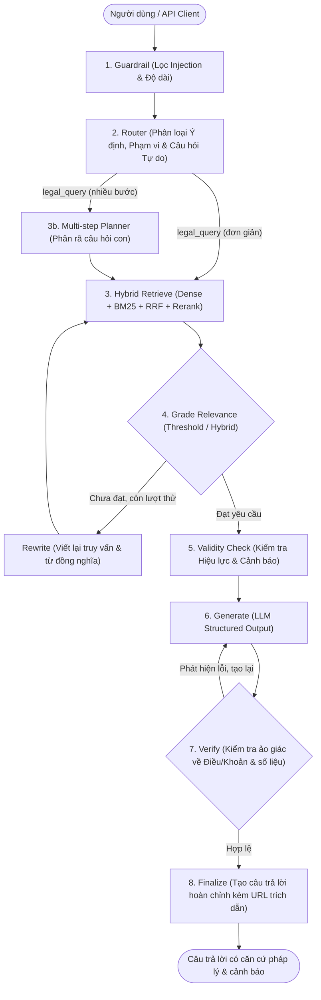

# ⚖️ Trợ Lý Pháp Luật Lao Động Việt Nam (Vietnamese Labor Law Legal RAG)

[](https://www.python.org/)
[](https://fastapi.tiangolo.com/)
[](https://github.com/langchain-ai/langgraph)
[](https://streamlit.io/)
[](https://qdrant.tech/)

> **Hệ thống Hỏi-Đáp Pháp luật Lao động Việt Nam Agentic RAG** xây dựng trên nền tảng LangChain và LangGraph, tích hợp mô hình phân chia cấu trúc Điều/Khoản, công cụ kiểm soát hiệu lực văn bản (Validity Management), đồ thị điều phối đa tác tử (Agentic Graph), truy xuất lai (Hybrid Dense + Syllable BM25 + RRF), quản lý phiên làm việc cô lập và tải lên tệp PDF.

---

> [!WARNING]
> **TUYÊN BỐ MIỄN TRỪ TRÁCH NHIỆM PHÁP LÝ (LEGAL DISCLAIMER)**:
> Hệ thống này được phát triển phục vụ mục đích nghiên cứu, học thuật và thử nghiệm công nghệ tra cứu ngữ nghĩa. Nội dung trả lời của hệ thống **KHÔNG PHẢI VÀ KHÔNG THAY THẾ CHO BẤT KỲ Ý KIẾN TƯ VẤN PHÁP LÝ CHÍNH THỨC NÀO** từ các luật sư, thẩm phán hoặc chuyên gia pháp lý được cấp chứng chỉ hành nghề. Người dùng chịu hoàn toàn trách nhiệm khi tham chiếu nội dung trong thực tế.

---

## 🌟 Tính Năng Nổi Bật (Key Features)

### 1. 📚 Linh Hoạt Nguồn Dữ Liệu: Dữ Liệu Có Sẵn & Tải Lên PDF Cá Nhân
Hệ thống hỗ trợ 2 chế độ dữ liệu song song hoặc kết hợp:
- **Cơ sở tri thức có sẵn (Pre-indexed Corpus)**: Tích hợp sẵn cơ sở dữ liệu luật pháp đồ sộ (Luật Bảo hiểm xã hội, Bảo hiểm y tế, An toàn vệ sinh lao động, các Nghị định/Thông tư hướng dẫn) được lưu trữ cấu trúc trong SQLite và chỉ mục vector trong Qdrant Local.
- **Tải lên tệp PDF tùy chỉnh (Custom PDF Document RAG)**: Người dùng có thể tải lên bất kỳ tài liệu nào (bản PDF số hóa text: *Bộ luật Lao động mới, Hợp đồng lao động, Thỏa ước lao động tập thể, Nội quy công ty, Quy chế lương thưởng*...). Hệ thống tự động:
  - Kiểm tra tính hợp lệ của tài liệu (chống file rỗng, file scan ảnh không có text).
  - Phân tích cấu trúc Điều/Khoản và tạo chunk ngữ nghĩa.
  - Tạo kho vector độc lập theo từng phiên (Session-isolated Vector Store) đảm bảo quyền riêng tư.
  - Trả lời và trích dẫn chuẩn xác theo trang/điều khoản có trong tài liệu vừa tải lên.

### 2. 🤖 Linh Hoạt Mô Hình LLM: Cloud API vs Local Offline (On-Premise)
Hệ thống được thiết kế theo kiến trúc Factory Pattern, dễ dàng chuyển đổi linh hoạt:
- **Chế độ Cloud API (Google Gemini, OpenAI, Groq)**:
  - Tối ưu cho người dùng muốn triển khai nhanh, không cần máy tính có phần cứng mạnh.
  - Mặc định hỗ trợ Google Gemini (`gemini-3.1-flash-lite`, `gemini-1.5-flash`, `gemini-1.5-pro`). Tốc độ phản hồi cực nhanh và khả năng suy luận logic xuất sắc.
- **Chế độ Local Offline (Ollama - Qwen 2.5 / Llama 3)**:
  - **Bảo mật tuyệt đối (100% On-Premise)**: Mọi dữ liệu câu hỏi và tài liệu tải lên không bao giờ gửi ra bên ngoài Internet. Rất phù hợp cho doanh nghiệp cần bảo mật hợp đồng và dữ liệu nội bộ.
  - **Không tốn phí & Không giới hạn Quota**: Không lo ngại lỗi hết hạn ngạch `429 Too Many Requests` hay chi phí gọi API.
  - Các thành phần nhúng (`AITeamVN/Vietnamese_Embedding`), rerank (`AITeamVN/Vietnamese_Reranker`) và CSDL vector (`Qdrant`) đều chạy hoàn toàn offline trên máy tính.

---

## 🏛️ Sơ Đồ Kiến Trúc Hệ Thống (Architecture)



Chi tiết xem tại [Tài liệu Kiến trúc Hệ thống](docs/architecture.md).

---

## ⚙️ Hướng Dẫn Cấu Hình Mô Hình (Model Configuration)

Hệ thống điều khiển qua file `.env` và `configs/models.yaml`. Bạn có thể chuyển đổi giữa 2 chế độ rất dễ dàng:

### Cách 1: Sử dụng Cloud API (Mặc định - Google Gemini)
Phù hợp nhất nếu bạn muốn chạy nhẹ nhàng và chất lượng suy luận cao nhất:
1. Đăng ký API Key miễn phí tại [Google AI Studio](https://aistudio.google.com/).
2. Trong file `.env`, thiết lập:
   ```env
   LLM_PROFILE=api_dev
   LLM_PROVIDER=google_genai
   LLM_MODEL=gemini-3.1-flash-lite
   JUDGE_MODEL=gemini-3.1-flash-lite
   GOOGLE_API_KEY=AIzaSy... (API Key của bạn)
   ```

### Cách 2: Sử dụng Local LLM Offline (Ollama - Qwen 2.5)
Phù hợp khi cần bảo mật tài liệu 100% nội bộ hoặc làm việc không có Internet:
1. Tải và cài đặt Ollama từ [ollama.com](https://ollama.com).
2. Tải mô hình Qwen 2.5 (hỗ trợ tiếng Việt và sinh JSON rất tốt):
   ```bash
   ollama run qwen2.5:7b
   ```
3. Cài đặt thư viện langchain-ollama trong môi trường ảo:
   ```bash
   pip install langchain-ollama
   ```
4. Cấu hình trong `.env`:
   ```env
   LLM_PROFILE=private
   OLLAMA_MODEL=qwen2.5:7b
   OLLAMA_BASE_URL=http://localhost:11434
   ```
5. Trong `configs/app.yaml`:
   ```yaml
   llm:
     profile: private
   ```

---

## 🚀 Hướng Dẫn Cài Đặt & Chạy Nhanh (Quickstart)

### 1. Kích hoạt Môi trường ảo Python (Python 3.11+)
```powershell
# Trên Windows PowerShell
.\.venv\Scripts\Activate.ps1

# Trên Linux / macOS
source .venv/bin/activate
```

### 2. Cấu hình Biến Môi trường
Sao chép `.env.example` thành `.env` và điền cấu hình mong muốn:
```bash
cp .env.example .env
```

### 3. Chạy qua CLI (Thử nghiệm nhanh)
```bash
# Chạy thử nghiệm với FakeLLM (không tốn quota)
python -m legalrag.cli ask "Thời giờ làm việc bình thường là mấy tiếng?" --fake

# Kiểm tra trạng thái hiệu lực của một văn bản quy phạm pháp luật
python -m legalrag.cli check-validity "17/2008/QH12"
```

### 4. Khởi động Toàn Bộ Giao Diện & Backend
Mở 2 cửa sổ terminal:

```bash
# Cửa sổ 1: Khởi động FastAPI Backend (Port 8000)
python -m uvicorn apps.api.main:app --host 0.0.0.0 --port 8000 --reload

# Cửa sổ 2: Khởi động Streamlit Web UI (Port 8501)
streamlit run apps/ui/app.py
```

- **Giao diện Web UI**: [http://localhost:8501](http://localhost:8501)
  - Chọn hỏi đáp trực tiếp theo CSDL luật pháp có sẵn.
  - Hoặc bấm mục **"Tải lên tài liệu PDF"** ở sidebar để tra cứu tài liệu riêng của bạn.
- **Swagger API Docs**: [http://localhost:8000/docs](http://localhost:8000/docs)
- **Liveness Probe**: [http://localhost:8000/health](http://localhost:8000/health)
- **Readiness Probe**: [http://localhost:8000/ready](http://localhost:8000/ready)

### 5. Chạy Với Docker Compose
```bash
docker compose up -d
```

---

## 📊 Kết Quả Thực Nghiệm Triệt Tiêu (Ablation Benchmark)

Kết quả đánh giá định lượng trên tập dữ liệu chuẩn **Golden Set** (109 câu hỏi được thẩm định):

| ID | Cấu hình Thử nghiệm | Pipeline | Recall@5 | MRR@10 | Citation Support | Refusal Acc | Validity Acc | LLM Calls TB | Độ trễ TB (ms) |
|:---|:---|:---:|:---:|:---:|:---:|:---:|:---:|:---:|:---:|
| **A1** | Dense-only (`Vietnamese_Embedding`) | `simple_rag` | 0.00% | 0.0000 | 100.0% | - | - | 1.00 | 40.65 |
| **A2** | Dense + Syllable BM25 + RRF | `simple_rag` | **80.00%** | **0.3333** | 100.0% | - | - | 1.00 | 417.18 |
| **A3** | A2 + Cross-Encoder Reranker | `simple_rag` | 50.00% | 0.2950 | 100.0% | - | - | 1.00 | 340.99 |
| **A4** | A3 + Parent Context Expansion | `simple_rag` | 50.00% | 0.2950 | 100.0% | - | - | 1.00 | 324.94 |
| **A5** | LangGraph Lean (Router + Rewrite loop) | `graph` | 14.29% | 0.1134 | 42.86% | 90.62% | - | 2.62 | 971.90 |
| **A6** | A5 + Cảnh báo Hiệu lực (`validity`) | `graph` | 14.29% | 0.1134 | 42.86% | 90.62% | 78.12% | 2.62 | 966.05 |
| **A7** | LangGraph Full (Planner + Hybrid + Verify) | `graph` | **30.36%** | **0.1950** | **100.0%** | **96.88%** | **75.00%** | 3.53 | 566.38 |

Chi tiết xem tại [Báo cáo Đánh giá Toàn diện](eval/report.md).

---

## 🧪 Kiểm Thử Hệ Thống (Testing)

Hệ thống sở hữu bộ kiểm thử tự động 100% độc lập, không phụ thuộc API từ xa:
```bash
# Chạy toàn bộ 73 bài kiểm tra đơn vị
pytest tests/unit/

# Kiểm tra quy chuẩn mã nguồn (linting)
ruff check src apps tests scripts
```

---

## 📂 Cấu Trúc Dự Án (Project Structure)

```text
├── apps/
│   ├── api/              # FastAPI Backend (REST & SSE Streaming)
│   └── ui/               # Streamlit Web UI (hỗ trợ upload PDF & chat)
├── configs/              # Cấu hình hệ thống (app.yaml, models.yaml, retrieval.yaml)
├── data/
│   ├── processed/        # Cơ sở dữ liệu SQLite (legalrag.db) và Qdrant local
│   └── uploads/          # Thư mục lưu trữ tạm thời các file tải lên
├── docs/                 # Tài liệu kỹ thuật, kiến trúc, ADR và limitations
├── eval/                 # Dữ liệu đánh giá Golden Set và kết quả ablation
├── scripts/              # Kịch bản thực thi pipeline ngoại tuyến (00 -> 09)
├── src/legalrag/         # Gói mã nguồn cốt lõi (core, data, ingestion, graph, retrieval, validity)
├── tests/                # Bộ kiểm thử đơn vị tự động (tests/unit/)
├── Dockerfile            # Multi-stage Docker build
├── docker-compose.yml    # Điều phối microservices (api, ui, qdrant)
├── Makefile              # Phím tắt các tác vụ chuẩn
└── pyproject.toml        # Khai báo phụ thuộc gói và extras
```

---

## 📚 Nguồn Dữ Liệu & Giấy Phép
- Dữ liệu văn bản quy phạm pháp luật được trích xuất từ tập snapshot ngày 10/09/2024 của bộ dữ liệu cộng đồng `bkai-foundation-models/vietnamese-legal-knowledge-base` trên HuggingFace.
- Giấy phép phân phối theo các điều khoản nguồn mở áp dụng cho dữ liệu văn bản pháp luật công khai tại Việt Nam.
