# Kiến Trúc Hệ Thống (System Architecture)

Dự án **Vietnamese Labor Law Legal RAG** được thiết kế theo mô hình Agentic RAG phân tầng với hai quy trình cốt lõi: **Quy trình Ngoại tuyến (Offline Pipeline)** và **Quy trình Trực tuyến (Online LangGraph Architecture)**.

---

## 1. Sơ đồ Kiến trúc Tổng thể (Overall Architecture)

```mermaid
flowchart TD
    subgraph Offline ["1. Quy trình Ngoại tuyến (Ingestion & Indexing)"]
        HF["HuggingFace Snapshot<br/>(2024-09-10)"] --> Filters["Bộ lọc & Chuẩn hóa<br/>(NFC, Clean text, Scope: Lao động)"]
        Filters --> DB[("SQLite Database<br/>documents, relations")]
        Filters --> Chunker["Legal Structural Chunker<br/>(Điều, Khoản, Tiền sự, Phẳng)"]
        Chunker --> Parents[("SQLite Database<br/>parents table")]
        Chunker --> Dense["Dense Embedder<br/>(Vietnamese_Embedding)"]
        Chunker --> Sparse["Syllable BM25<br/>(Bigram tokenizer)"]
        Dense --> Qdrant[("Qdrant Vector DB<br/>Dense + Sparse Vectors")]
        Sparse --> Qdrant
    end

    subgraph Online ["2. Quy trình Trực tuyến (LangGraph Agentic Flow)"]
        User(["Người dùng / API Client"]) --> Guardrail["Guardrail Node<br/>(Max length, Injection filter)"]
        Guardrail --> Router["Router Node<br/>(Intent, Scope, Complexity, Standalone Q)"]

        Router -->|"out_of_scope"| OutOfScope["Out of Scope Node"]
        Router -->|"chitchat"| Chitchat["Chitchat Node"]
        Router -->|"needs_clarification"| Clarify["Clarify Node<br/>(LangGraph Interrupt)"]
        Clarify -.->|"Resume"| Router

        Router -->|"legal_query (simple)"| Retrieve["Retrieve Node<br/>(Dense + BM25 + RRF + Reranker)"]
        Router -->|"legal_query (multi_step)"| Planner["Multi-step Planner Subgraph<br/>(Sub-questions -> Parallel Retrieve -> Merge)"]
        Planner --> Retrieve

        Retrieve --> Grade{"Grade Node<br/>(Threshold / Hybrid Mode)"}
        Grade -->|"insufficient (retries < 2)"| Rewrite["Rewrite Node<br/>(Tăng từ đồng nghĩa, sửa truy vấn)"]
        Rewrite --> Retrieve
        Grade -->|"insufficient (retries >= 2)"| GiveUp["Give Up Node<br/>(Không đủ căn cứ)"]

        Grade -->|"ok"| Validity["Validity Check Node<br/>(Kiểm tra Hiệu lực & Cảnh báo)"]
        Validity --> Generate["Generate Node<br/>(LLM Structured Output)"]
        Generate --> Verify{"Verify Node<br/>(Code rules + LLM NLI)"}

        Verify -->|"pass"| Finalize["Finalize Node<br/>(Ghép câu trả lời, Căn cứ pháp lý, Cảnh báo)"]
        Verify -->|"fail (regen < 1)"| Generate
        Verify -->|"fail (regen >= 1)"| GiveUp

        Finalize --> Output(["Câu trả lời có trích dẫn & cảnh báo"])
    end

    subgraph UserUpload ["3. Quản lý Phiên & Tài liệu Tải lên (Upload & Session Isolation)"]
        UploadPDF["Tải lên PDF (HĐLĐ, Quy chế)"] --> PDFLoader["PyMuPDF Loader<br/>(Magic bytes, Anti-scan, Chars threshold)"]
        PDFLoader --> SessionMgr["Session Manager"]
        SessionMgr --> SessionParents[("SQLite parents<br/>session_id, expires_at")]
        SessionMgr --> SessionQdrant[("Qdrant Vectors<br/>session_id payload")]
        TTL["TTL Cleanup Cron<br/>(24h auto-purge)"] -.-> SessionMgr
    end
```

---

## 2. Các Thành phần Hệ thống Chi tiết

### 2.1. Ingestion & Chunking (`legalrag.ingestion`)
- **Bộ chia văn bản pháp lý (`LegalChunker`)**:
  - Không cắt đoạn tùy tiện theo độ dài ký tự cố định.
  - Phân tích cú pháp Điều/Khoản (`Điều \d+`, `\d+\. `).
  - Tách đơn vị cha (**Parent**) ở cấp **Điều** (Article) và các đơn vị con (**Chunk**) ở cấp **Khoản** (Clause).
  - Khi tra cứu, embedding đối sánh ở cấp Khoản (độ chính xác cục bộ cao), nhưng khi đưa vào prompt của LLM sẽ mở rộng lấy toàn bộ Điều cha (Parent context expansion) để không làm mất ngữ cảnh toàn diện.

### 2.2. Động cơ Truy xuất Lai (`legalrag.retrieval`)
- **Dense Retrieval**: Biểu diễn ngữ nghĩa bằng vector mật độ cao (Cosine similarity).
- **Sparse Retrieval**: `SyllableBM25` với tokenizer âm tiết tiếng Việt kết hợp bigram kế cận (hashing 32-bit).
- **Hợp nhất Reciprocal Rank Fusion (RRF)**:
  $$\text{RRF}(d) = \sum_{m \in \{\text{dense}, \text{sparse}\}} \frac{1}{60 + \text{rank}_m(d)}$$
- **Reranker**: Mô hình Cross-Encoder tiếng Việt chấm điểm tương thích trực tiếp cặp `(query, passage)`.

### 2.3. Quản lý Hiệu lực Văn bản (`legalrag.validity`)
- Truy vấn đồ thị quan hệ trong SQLite (`documents`, `relations`).
- Tự động phát hiện trạng thái:
  - `EXPIRED`: Đã hết hiệu lực toàn bộ (kèm văn bản thay thế nếu có).
  - `PARTIALLY_EXPIRED`: Hết hiệu lực một phần (cảnh báo đối chiếu).
  - `AMENDS`: Văn bản đã được sửa đổi, bổ sung bởi văn bản mới hơn.
- Mở rộng văn bản thay thế (`expand_replacements`): Tự động nạp tối đa 2 parent của văn bản thay thế vào ngữ cảnh.

### 2.4. Đồ thị Điều phối Đa tác tử LangGraph (`legalrag.graph`)
- **Guardrail**: Lọc câu hỏi độc hại, prompt injection.
- **Router**: Phân loại ý định, phạm vi và độ phức tạp trong một lượt gọi duy nhất.
- **Multi-step Planner**: Phân tách truy vấn phức tạp thành nhiều câu hỏi con, tra cứu song song và khử trùng theo token budget.
- **Grade & Rewrite**: Vòng lặp tự kiểm tra chất lượng tài liệu tìm kiếm và tự động viết lại truy vấn nếu chưa đạt ngưỡng.
- **Verify**: Kiểm tra chéo độc lập trước khi gửi câu trả lời (phát hiện hallucination về số Điều, Khoản, số tiền).

### 2.5. Lớp Dịch vụ & Giao diện (`apps/`)
- **FastAPI Backend**: Cung cấp REST API đầy đủ và Server-Sent Events (SSE) streaming cho phép người dùng quan sát từng bước thực thi trong thời gian thực.
- **Streamlit Web UI**: Giao diện tương tác thân thiện, hỗ trợ tải file PDF, hiển thị trích dẫn có đường dẫn tra cứu và cảnh báo hiệu lực trực quan.
